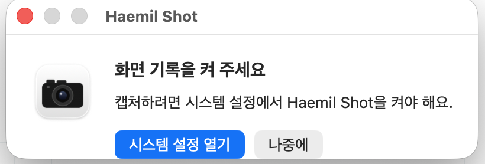

<p align="center"></p>

# 해밀 Shot (Haemil Shot)

단축키 한 번으로 화면을 찍어 바로 클립보드에 넣는 맥 메뉴 막대 앱입니다.
찍고 나면 알림이 뜨고, 알림을 누르면 편집기가 열립니다. 편집기는 [Bend](https://github.com/HigherOrderCo/Bend) 언어로 썼습니다.

- 영역 캡처와 전체 화면 캡처는 찍는 즉시 클립보드에 들어갑니다. 바로 붙여 넣으면 됩니다.
- 편집기에는 펜, 형광펜, 네모, 원, 직선, 화살표, 모자이크, 자르기, 지우개가 있습니다. 색은 빨강, 노랑, 초록, 파랑, 검정, 하양 중에서 고릅니다.
- 되돌리기와 다시 실행이 됩니다. 편집은 고칠 때마다 자동 저장되어, 나중에 다시 열어도 이어서 고칠 수 있습니다.
- 편집기 오른쪽에 최근 캡처 30개가 있습니다. 눌러서 열고, × 로 지웁니다.

## 단축키

| 키 | 동작 |
| --- | --- |
| ⌃⌥S | 영역 캡처 |
| ⌃⌥⇧S | 전체 화면 캡처 |
| ⌃⌥E | 마지막 캡처 편집 |

메뉴 막대 아이콘을 눌러도 같은 일을 할 수 있습니다.

편집기 안에서는 이 키를 씁니다.

| 키 | 동작 |
| --- | --- |
| 1 | 네모 |
| 2 | 모자이크 |
| 3 | 자르기 |
| 4 | 펜 |
| 5 | 형광펜 |
| 6 | 직선 |
| 7 | 화살표 |
| 8 | 원 |
| 9 | 지우개 |
| Z (한글 자판 ㅋ) | 되돌리기 |
| Y (한글 자판 ㅛ) | 다시 실행 |
| Enter | 편집한 그림을 클립보드에 넣고 닫기 |
| Esc | 닫기. 고친 것이 있으면 두 번 눌러야 닫힙니다 |

## 설치

1. [최신 HaemilShot.dmg](https://github.com/ShinKwangsub/haemil-shot/releases/latest/download/HaemilShot.dmg) 를 받아 엽니다.
2. Haemil Shot 을 응용 프로그램(Applications) 폴더로 끌어 놓고 실행합니다.
3. 처음 한 번은 화면 기록 권한이 필요합니다. 아래 창이 뜨면 **시스템 설정 열기** 를 누르고, **개인정보 보호 및 보안 > 화면 및 시스템 오디오 녹음** 에서 Haemil Shot 을 켭니다. 시스템 설정이 앱을 다시 열겠냐고 물으면 다시 엽니다.

<p align="center"></p>

애플 공증을 받은 앱이라 경고 없이 열립니다.
응용 프로그램 폴더에서 실행하면 로그인 항목에 등록되어 다음부터 자동으로 켜집니다. 끄고 싶으면 **시스템 설정 > 일반 > 로그인 항목** 에서 끕니다.

## 요구 사항

맥 13 (Ventura) 이상. 애플 실리콘과 인텔 맥 모두 지원합니다.

## 개인정보

캡처는 모두 내 맥의 `~/Library/Caches/BendShot` 에만 저장됩니다. 앱은 인터넷에 접속하지 않고, 아무것도 밖으로 보내지 않습니다.
보관은 최근 30개까지입니다. 새 캡처로 30개를 넘으면 가장 오래된 캡처는 휴지통을 거치지 않고 바로 지워집니다. 목록에서 × 로 지운 캡처는 휴지통으로 갑니다.

## 어떻게 만들었나

- 편집기(`shot.bend`, `core.bend`)는 Bend 2 로 썼습니다. 메뉴 막대, 단축키, 알림, 권한 안내는 `app/main.swift` 가 맡습니다.
- `core.bend` 는 편집 상태와 키·마우스 입력에 따른 상태 변화를 정합니다. `LAWS.bend` 에는 이 상태 변화가 지켜야 할 33개 규칙(`law`)이 있습니다. 예를 들어 "Enter 면 반드시 복사, 그 밖의 키는 복사 없음", "기록을 바꾸는 행동마다 자동 저장" 같은 것입니다.
- `PROOF.bend` 는 그 규칙들의 증명입니다. `bend PROOF.bend` 가 `ALL PROOFS CHECK` 를 내야만 빌드가 됩니다. 증명은 `tools/gen_proof.py` 가 만듭니다.
- `test/verify.py` 는 실제 실행 파일로 그림을 편집해, 결과를 Python 으로 짠 기준 구현과 픽셀 단위로 비교합니다. 보관과 자동 저장은 가짜 `HOME` 에서 검사합니다.

## 소스에서 빌드

필요한 것: [Bend](https://github.com/HigherOrderCo/Bend) 2.0.39 (`~/.bend/bin/bend`), Xcode 명령줄 도구.

```sh
~/.bend/bin/bend PROOF.bend     # ALL PROOFS CHECK
./build.sh                      # 검사용 ./shot (이 맥 아키텍처)
python3 -I test/verify.py       # 마지막 줄 "실패 0 개"
dist/build.sh                   # dist/out/Haemil Shot.app (애플 실리콘 + 인텔)
dist/release.sh                 # 서명·공증한 dist/out/HaemilShot-<버전>.dmg (Developer ID 인증서와 notarytool 프로필 필요)
assets/make_icons.sh            # assets/icon.swift 로 아이콘 다시 그리기
```

`dist/build.sh` 는 키체인에 Developer ID 인증서가 없으면 임시 서명합니다. 이 경우 다시 빌드할 때마다 화면 기록 권한을 다시 줘야 합니다.
앱 짜임과 화면 기록 권한이 어떻게 이어지는지는 [dist/NOTES.md](dist/NOTES.md) 에 있습니다.

## 라이선스

MIT ([LICENSE](LICENSE)). 편집기 바이너리에는 Apache 2.0 라이선스인 Bend 런타임이 들어 있습니다 ([NOTICE](NOTICE), [licenses/Bend-Apache-2.0.txt](licenses/Bend-Apache-2.0.txt)).

---

## English

Haemil Shot is a macOS menu bar app for screenshots. ⌃⌥S captures an area and ⌃⌥⇧S the full screen, and the image goes straight to the clipboard. Click the notification (or press ⌃⌥E) to open the editor: pen, highlighter, box, ellipse, line, arrow, mosaic, crop and eraser, with undo and redo. The editor keeps your 30 most recent captures.

- **Install:** download [HaemilShot.dmg](https://github.com/ShinKwangsub/haemil-shot/releases/latest/download/HaemilShot.dmg), drag Haemil Shot to Applications, open it, and allow it under *System Settings > Privacy & Security > Screen & System Audio Recording*. macOS 13+, Apple silicon and Intel, notarized.
- **Privacy:** captures stay in `~/Library/Caches/BendShot` on your Mac. The app makes no network connections. Deleting a capture from the list moves it to the Trash.
- **Build:** Bend 2.0.39 at `~/.bend/bin/bend` and the Xcode command line tools. `bend PROOF.bend` checks the 33 laws in `LAWS.bend`, `./build.sh` builds the test binary, `python3 -I test/verify.py` runs the pixel tests, `dist/build.sh` builds the app.
- **License:** MIT. The editor binary includes the Bend runtime (Apache 2.0), see `NOTICE`.
